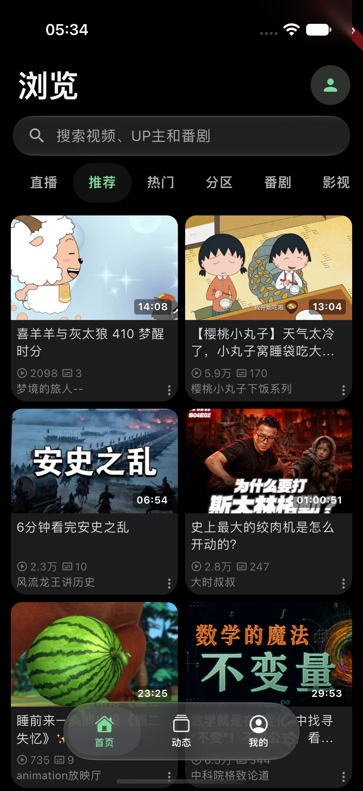
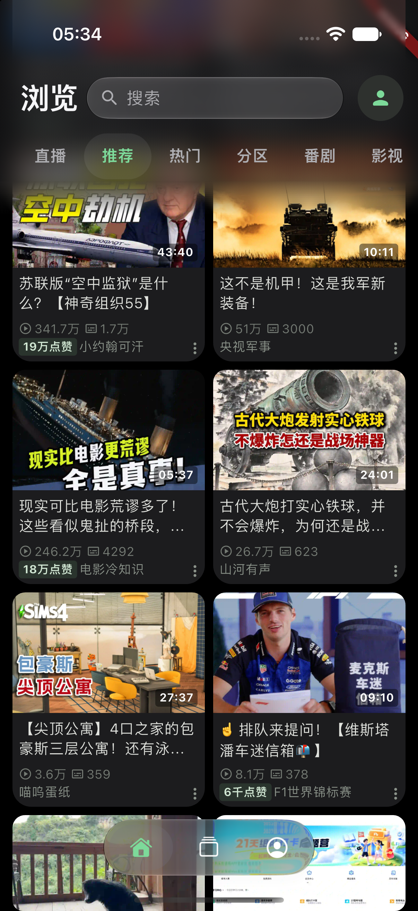
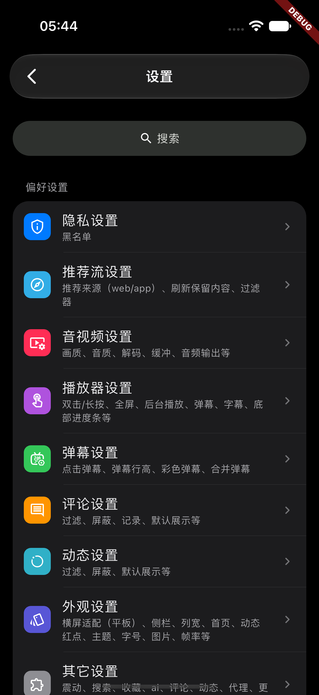

  
  <h1>PiliPlus Liquid Glass</h1>
  
An iOS interface fork of PiliPlus

  
Native glass surfaces · Scroll-responsive navigation · iPhone and iPhone Duo layouts

[中文](README.md) · English

[Download](https://github.com/MichaelXiao-GIS/PiliPlus-LiquidGlass/releases) · [Installation guide](docs/ios-testing.md) · [Upstream PiliPlus](https://github.com/bggRGjQaUbCoE/PiliPlus)

## About

**PiliPlus Liquid Glass** is a modified version of [PiliPlus](https://github.com/bggRGjQaUbCoE/PiliPlus), a third-party Bilibili client built with Flutter. It retains the upstream app's functionality while adapting navigation, search, settings and player controls for iOS.

This repository focuses on iPhone test builds, including window, safe-area and rotation handling for iOS 27.1 and iPhone Duo. Source code for other platforms is inherited from upstream; the Liquid Glass changes and releases presented here focus on iOS.

## Changes in this fork

| Area | Experience |
| --- | --- |
| Home and search | A transparent header gains a soft blur while scrolling. The search field narrows and moves upward along a continuous arc, then expands at the top. Category tabs remain distinct. |
| Glass navigation | A centered floating tab bar hides its labels while scrolling. Both the bottom bar and sidebar support a droplet-shaped indicator that follows a sliding gesture. |
| Landscape and Duo | Navigation adapts to the window, fold regions and camera position, reducing unused strips and content occlusion. |
| Video player | Separate title, shortcut and centered progress controls retain CC subtitles, speed and quality controls. The More menu groups secondary actions. |
| Settings and transitions | Grouped settings, light and dark themes, and iOS page transitions by default. Existing animation choices, text scaling and system accessibility preferences are retained. |

Video, anime, live streams, feeds, comments, favorites, history and offline caching come from PiliPlus. Availability depends on account permissions, the content and Bilibili's services.

## Current interface

These are actual **2.1.6 / test build 18** simulator screenshots showing the expanded home header, its scrolled state and grouped settings in dark mode. The app is signed out. The DEBUG banner belongs to the debug build and is absent from the Release IPA.

<table>
  <tr>
    <th>Home · Expanded</th>
    <th>Home · Scrolled</th>
    <th>Grouped settings</th>
  </tr>
  <tr>
    <td></td>
    <td></td>
    <td></td>
  </tr>
</table>

## Download and install

Get the IPA from this repository's [Releases](https://github.com/MichaelXiao-GIS/PiliPlus-LiquidGlass/releases). The current version is [PiliPlus Liquid Glass test build 18](https://github.com/MichaelXiao-GIS/PiliPlus-LiquidGlass/releases/tag/v2.1.6-liquid-glass.test18), app version 2.1.6, build 18. Check Releases for subsequent updates.

- **Package:** an arm64 Release build for iPhone, requiring iOS 15 or later.
- **Glass effects:** native Liquid Glass on iOS 26 and later, with a compatible material on older systems.
- **Signing:** re-sign the IPA with your own Apple ID using AltStore or Sideloadly before installing. Keep the same signing identity and app identifier when updating.
- **Assets:** IPA, `SHA256SUMS.txt` and `build-info.json`.

See the [installation guide](docs/ios-testing.md) for details (Chinese).

## Development and feedback

The [iOS adaptation and build guide](docs/ios-liquid-glass.md) covers the development environment, glass implementation and build process (Chinese). Release builds use `lib/main.dart`.

Report fork-specific problems in [this repository's Issues](https://github.com/MichaelXiao-GIS/PiliPlus-LiquidGlass/issues), including the build number, device, OS version, orientation, reproduction steps and screenshots. Redact personal information before attaching screenshots.

## Origin and disclaimer

This is an **independently maintained modification of PiliPlus**, focused on iOS Liquid Glass and adaptive layouts. It is not a client built from scratch or an official Bilibili app. Changes and test packages published here are maintained by this repository and do not represent upstream PiliPlus releases.

Thanks to these projects and all their contributors:

- [bggRGjQaUbCoE/PiliPlus](https://github.com/bggRGjQaUbCoE/PiliPlus), the direct upstream of this fork.
- [orz12/PiliPalaX](https://github.com/orz12/PiliPalaX), the upstream of PiliPlus.
- [guozhigq/pilipala](https://github.com/guozhigq/pilipala), the original project.

This project is intended for open-source learning, interface research and personal testing. It does not provide cracked content or bypass paid access. Bilibili names, images and videos belong to their respective rights holders; screenshots illustrate the client interface.

This repository retains the upstream copyright notices and **GNU GPL v3** license. Use, modification and redistribution are governed by [LICENSE](LICENSE). The software is provided without warranty as described in that license.

## Other acknowledgements

- [bilibili-API-collect](https://github.com/SocialSisterYi/bilibili-API-collect)
- [flutter_meedu_videoplayer](https://github.com/zezo357/flutter_meedu_videoplayer)
- [media-kit](https://github.com/media-kit/media-kit)
- [dio](https://pub.dev/packages/dio)
- The other open-source dependencies and contributors of PiliPlus.
