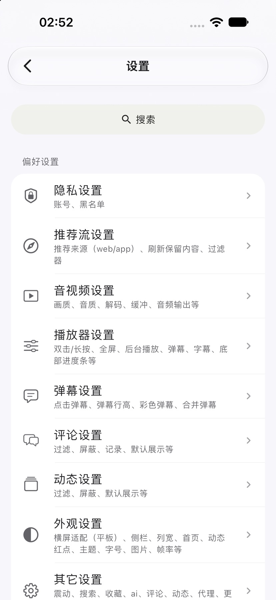

  
  <h1>PiliPlus Liquid Glass</h1>
  
基于 PiliPlus 的 iOS 界面改造分支

  
原生玻璃质感 · iPad 与 iPhone Duo 布局适配

中文 · [English](README.en.md)

[下载测试版](https://github.com/MichaelXiao-GIS/PiliPlus-LiquidGlass/releases) · [安装说明](docs/ios-testing.md) · [上游 PiliPlus](https://github.com/bggRGjQaUbCoE/PiliPlus)

## 关于本项目

**PiliPlus Liquid Glass** 是在 [PiliPlus](https://github.com/bggRGjQaUbCoE/PiliPlus) 基础上修改的第三方 Bilibili 客户端，沿用 Flutter 技术栈与上游业务功能，主要改进 iOS 的导航、搜索、设置和播放界面。

本仓库重点维护 iPhone 测试版，并针对 iOS 27.1 与 iPhone Duo 的窗口、安全区和旋转布局进行适配。其他平台的源码继承自上游；本页展示和发布的 Liquid Glass 改动以 iOS 为主。

本项目基于 [PiliPlus 2.2.0.2](https://github.com/bggRGjQaUbCoE/PiliPlus/releases/tag/2.2.0.2)。上游改进了视频选集和番剧下载入口，修复了部分视频评论加载不全的问题。

iOS 主导航使用系统标签栏。浏览首页时，底栏会随滚动收起和展开。在 iPhone Duo 横屏上，慢拖侧栏可以看到放大的选框和标签名称。

## 本分支的主要改动

| 界面 | 当前体验 |
| --- | --- |
| 首页与搜索 | 透明顶区随滚动柔和模糊；搜索框沿连续弧线缩窄并上移，回到顶部时展开，分类选项保持清晰可辨。 |
| 玻璃导航 | iOS 26 及以上使用系统玻璃标签栏。切换首页、动态和我的后，各页保留浏览位置。 |
| 横屏与 Duo | 根据窗口切换底栏或侧栏，处理折叠区域和摄像头位置，减少整条空白与内容遮挡。 |
| 视频播放 | 全屏控件分成标题、快捷操作和居中进度栏；保留 CC 字幕、倍速与画质入口，更多菜单按功能分组。 |
| 设置与页面切换 | 分组设置、深浅色主题、默认 iOS 页面过渡；保留原有动画选项，并支持字号调整与系统辅助功能。 |

视频、番剧、直播、动态、评论、收藏、历史记录、离线缓存等功能来自 PiliPlus。各项服务的可用性取决于账号权限、视频内容和 Bilibili 服务状态。

## 当前界面

以下是测试版 30 的模拟器截图。

[查看 Duo 横屏慢拖标签时的系统选框](assets/screenshots/liquid_glass/duo-tab-drag-test30.jpg)。

<table>
  <tr>
    <th>13 英寸 iPad Pro · 横屏</th>
    <th>iPhone Duo · 展开横屏</th>
  </tr>
  <tr>
    <td></td>
    <td></td>
  </tr>
</table>

<table>
  <tr>
    <th>iPhone · 首页</th>
    <th>iPhone · 滚动后</th>
    <th>iPhone · 设置</th>
  </tr>
  <tr>
    <td></td>
    <td></td>
    <td></td>
  </tr>
</table>

## 下载与安装

前往本仓库的 [Releases](https://github.com/MichaelXiao-GIS/PiliPlus-LiquidGlass/releases) 下载 IPA。当前版本为 [PiliPlus Liquid Glass 测试版 30](https://github.com/MichaelXiao-GIS/PiliPlus-LiquidGlass/releases/tag/v2.2.0-liquid-glass.test30)（应用版本 2.2.0，构建号 30）。后续更新以 Releases 为准。

- **安装包**：iPhone arm64 Release，最低支持 iOS 15。
- **玻璃效果**：iOS 26 及以上使用原生 Liquid Glass；较旧系统使用兼容材质。
- **签名安装**：IPA 需要先通过 AltStore 或 Sideloadly，使用自己的 Apple ID 重新签名。覆盖更新时保持签名与应用标识一致。
- **附件**：每个版本提供 IPA、`SHA256SUMS.txt` 和 `build-info.json`。

详细步骤见 [iPhone 测试版安装说明](docs/ios-testing.md)。

## 开发与反馈

[iOS 适配与构建说明](docs/ios-liquid-glass.md) 包含开发环境、原生玻璃实现和构建方式。发布包使用 `lib/main.dart` 作为入口。

遇到本分支的问题，请在 [本仓库 Issues](https://github.com/MichaelXiao-GIS/PiliPlus-LiquidGlass/issues) 附上版本号、设备与系统版本、旋转方向、复现步骤及截图。提交截图前请遮挡个人信息。

## 项目来源与声明

本项目是 **PiliPlus 的独立修改分支**，主要增加 iOS Liquid Glass 界面与设备布局适配，并非从零开发的客户端，也不是 Bilibili 官方应用。此分支的改动和测试包由本仓库维护，不代表上游 PiliPlus 的发布版本。

感谢以下项目及所有贡献者：

- [bggRGjQaUbCoE/PiliPlus](https://github.com/bggRGjQaUbCoE/PiliPlus)：本项目直接基于的上游。
- [orz12/PiliPalaX](https://github.com/orz12/PiliPalaX)：PiliPlus 的上游项目。
- [guozhigq/pilipala](https://github.com/guozhigq/pilipala)：原始项目。

本项目用于开源学习、界面研究与个人测试，不提供破解内容或绕过付费权限的功能。Bilibili 及相关名称、图像和视频内容的权利归各自权利人所有；截图仅用于展示客户端界面。

本仓库沿用 **GNU GPL v3** 许可证，保留上游版权及许可声明。使用、修改和分发请遵循 [LICENSE](LICENSE)；软件按许可证约定提供，不作保证。

## 其他致谢

- [bilibili-API-collect](https://github.com/SocialSisterYi/bilibili-API-collect)
- [flutter_meedu_videoplayer](https://github.com/zezo357/flutter_meedu_videoplayer)
- [media-kit](https://github.com/media-kit/media-kit)
- [dio](https://pub.dev/packages/dio)
- PiliPlus 的其他开源依赖及贡献者。
